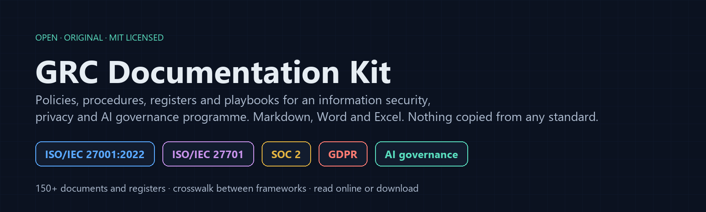
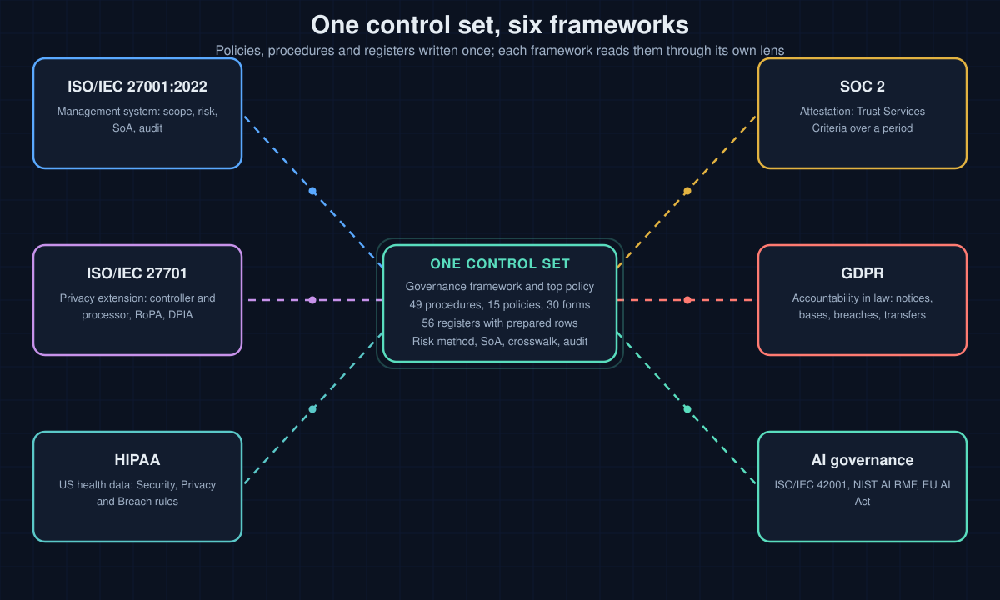
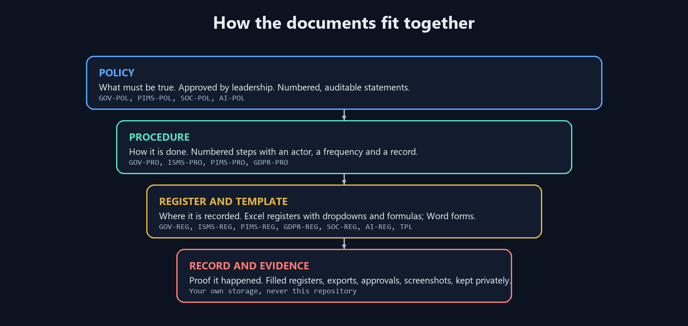

<p align="center"></p>

<p align="center">
  <a href="https://abdullahzarshaid.github.io/grc-documentation-kit/kit.html"></a>
  &nbsp;
  <a href="https://github.com/abdullahzarshaid/grc-documentation-kit/releases/latest"></a>
  &nbsp;
  <a href="https://abdullahzarshaid.com/"></a>
</p>


**An open documentation kit for running an information security, privacy and AI governance programme.** Policies, procedures, plans, forms, playbooks and Excel registers, written once and mapped to ISO/IEC 27001:2022, ISO/IEC 27701, SOC 2, GDPR, HIPAA and AI governance frameworks. Every document is an original template: it cites clause, control, criterion and article numbers and reproduces none of the standards' text.

<p align="center"></p>

## What you get

| | |
|---|---|
| **Markdown masters** in `src/` | The source of truth. Readable on GitHub, easy to fork and edit, every file with a front matter block that states what it serves and who owns it. |
| **Word documents** in `kit/` | Built from the masters: document control block, revision history, numbered statements, footer with ID and version. Ready to put your name on. |
| **Excel registers** in `kit/` | Built from `src/registers/*.yaml`: frozen header, dropdowns, formulas, pale-yellow input cells, 100 prepared rows. The Statement of Applicability, the control matrices and the checklists come pre-filled with every control, criterion or question. |
| **Playbooks** | How to run the work: ISO/IEC 27001 in twelve steps, SOC 2 Type 2 in 90 days, GDPR operations in ten steps, adding ISO/IEC 27701, the first internal audit cycle, the go-live gate, the readiness questionnaire, evidence management, combining frameworks. |
| **Crosswalk** | One workbook mapping the 93 Annex A controls to SOC 2 criteria, GDPR articles, NIST CSF 2.0 categories and the kit documents that address each. |
| **A site** | [Read every document online](https://abdullahzarshaid.github.io/grc-documentation-kit/kit.html) with search, or start at the [overview](https://abdullahzarshaid.github.io/grc-documentation-kit/). |

<p align="center"></p>

## Start here

1. Read [PB-01, how to use this kit](src/cross/pb-01-how-to-use-this-kit.md).
2. Pick a path: [ISO/IEC 27001 in twelve steps](src/cross/pb-02-iso-27001-in-twelve-steps.md), [SOC 2 Type 2 in 90 days](src/cross/pb-03-soc-2-type-2-readiness-in-90-days.md), [GDPR operations in ten steps](src/cross/pb-04-gdpr-operations-in-ten-steps.md), or [adding ISO/IEC 27701 to an ISMS](src/cross/pb-05-adding-privacy-to-an-isms.md).
3. Download the [latest release](https://github.com/abdullahzarshaid/grc-documentation-kit/releases/latest) for the Word and Excel files, or clone the repository and build them yourself.
4. Replace every item in square brackets, remove what does not apply, have the approver sign, and keep the filled copies in your own storage.

<p align="center"></p>

## What it is not

- Not a certification, an attestation or legal advice. A template proves nothing until it is adopted, followed and evidenced.
- Not a copy of any standard. Buy ISO/IEC 27001 and ISO/IEC 27701 from ISO or your national body; the SOC 2 criteria come from the AICPA; the GDPR text is on EUR-Lex. The kit tells you where each document fits; it does not replace reading the requirement.
- Not a place for your records. Filled registers, evidence and anything that names a real organisation stay in your own controlled storage. Never commit them to a fork.

## Build it yourself

```bash
git clone https://github.com/abdullahzarshaid/grc-documentation-kit.git
cd grc-documentation-kit
python -m pip install python-docx openpyxl PyYAML markdown-it-py
python tools/registers.py      # YAML specs -> Excel registers in kit/
python tools/build.py          # Markdown masters -> Word documents, docs/kit.html, this index
python tools/checksums.py      # record SHA-256 of every built file
python tools/verify.py         # front matter, headings, banned terms, dashes, cross references, layout, checksums
```

The continuous check on every push rebuilds everything from source and runs the same verification, so the published Word and Excel files always match the Markdown.

## Document index

IDs are permanent. Prefixes: GOV (governance and operations shared by every framework), ISMS (ISO/IEC 27001 specific), PIMS (ISO/IEC 27701 specific), SOC (SOC 2 specific), GDPR, AI, PB (playbooks). Types: POL policy, PRO procedure, PLN plan, STM statement, TPL template, CHK checklist, GDE guide, REG register.

<!-- INDEX:START -->

### ISO/IEC 27001:2022

Information security management system.

| ID | Document | Type | Serves | Download |
|---|---|---|---|---|
| ISMS-GDE-01 | [Guide: the 93 Annex A controls and where the kit covers each](src/iso27001/isms-gde-01-annex-a-control-guide.md) | guide | ISO/IEC 27001:2022 Annex A; ISO/IEC 27001:2022 clause 6.1.3 | [.docx](kit/iso27001/isms-gde-01-annex-a-control-guide.docx) |
| ISMS-GDE-02 | [Guide: mandatory documented information and records for ISO/IEC 27001:2022](src/iso27001/isms-gde-02-mandatory-documents-map.md) | guide | ISO/IEC 27001:2022 clause 4.3; ISO/IEC 27001:2022 clause 5.2; ISO/IEC 27001:2022 clause 6.1.2; ISO/IEC 27001:2022 clause 6.1.3; ISO/IEC 27001:2022 clause 6.2; ISO/IEC 27001:2022 clause 7.2; ISO/IEC 27001:2022 clause 7.5; ISO/IEC 27001:2022 clause 8.1; ISO/IEC 27001:2022 clause 8.2; ISO/IEC 27001:2022 clause 8.3; ISO/IEC 27001:2022 clause 9.1; ISO/IEC 27001:2022 clause 9.2; ISO/IEC 27001:2022 clause 9.3; ISO/IEC 27001:2022 clause 10.2 | [.docx](kit/iso27001/isms-gde-02-mandatory-documents-map.docx) |
| ISMS-GDE-03 | [Guide: the certification journey from decision to recertification](src/iso27001/isms-gde-03-certification-journey.md) | guide | ISO/IEC 27001:2022 clause 4.3; ISO/IEC 27001:2022 clause 6.1.3; ISO/IEC 27001:2022 clause 9.2; ISO/IEC 27001:2022 clause 9.3; ISO/IEC 27001:2022 clause 10.2 | [.docx](kit/iso27001/isms-gde-03-certification-journey.docx) |
| ISMS-PLN-01 | [Information security objectives and plan](src/iso27001/isms-pln-01-security-objectives-plan.md) | plan | ISO/IEC 27001:2022 clause 6.2; ISO/IEC 27001:2022 clause 5.2; ISO/IEC 27001:2022 clause 9.1; SOC 2 CC3.1 | [.docx](kit/iso27001/isms-pln-01-security-objectives-plan.docx) |
| ISMS-PLN-02 | [Communication plan](src/iso27001/isms-pln-02-communication-plan.md) | plan | ISO/IEC 27001:2022 clause 7.4; ISO/IEC 27701 clause 6.4.4; SOC 2 CC2.2; SOC 2 CC2.3 | [.docx](kit/iso27001/isms-pln-02-communication-plan.docx) |
| ISMS-PLN-03 | [Annual internal audit plan](src/iso27001/isms-pln-03-annual-audit-plan.md) | plan | ISO/IEC 27001:2022 clause 9.2.1; ISO/IEC 27001:2022 clause 9.2.2; ISO/IEC 27001:2022 Annex A 5.35; SOC 2 CC4.1 | [.docx](kit/iso27001/isms-pln-03-annual-audit-plan.docx) |
| ISMS-PRO-01 | [Context of the organisation and interested parties procedure](src/iso27001/isms-pro-01-context-and-interested-parties-procedure.md) | procedure | ISO/IEC 27001:2022 clause 4.1; ISO/IEC 27001:2022 clause 4.2; ISO/IEC 27001:2022 clause 4.3; ISO/IEC 27701 clause 5.2.1; ISO/IEC 27701 clause 5.2.2; SOC 2 CC3.1 | [.docx](kit/iso27001/isms-pro-01-context-and-interested-parties-procedure.docx) |
| ISMS-PRO-02 | [Competence and awareness procedure](src/iso27001/isms-pro-02-competence-procedure.md) | procedure | ISO/IEC 27001:2022 clause 7.2; ISO/IEC 27001:2022 clause 7.3; ISO/IEC 27001:2022 Annex A 6.3; SOC 2 CC1.4 | [.docx](kit/iso27001/isms-pro-02-competence-procedure.docx) |
| ISMS-PRO-03 | [Operational planning and control procedure](src/iso27001/isms-pro-03-operational-planning-and-control-procedure.md) | procedure | ISO/IEC 27001:2022 clause 8.1; ISO/IEC 27001:2022 clause 6.3; ISO/IEC 27001:2022 clause 6.1.3; SOC 2 CC5.1; SOC 2 CC5.3 | [.docx](kit/iso27001/isms-pro-03-operational-planning-and-control-procedure.docx) |
| ISMS-PRO-04 | [Monitoring, measurement, analysis and evaluation procedure](src/iso27001/isms-pro-04-monitoring-and-measurement-procedure.md) | procedure | ISO/IEC 27001:2022 clause 9.1; ISO/IEC 27001:2022 clause 6.2; ISO/IEC 27001:2022 Annex A 5.36; SOC 2 CC4.1; SOC 2 CC4.2 | [.docx](kit/iso27001/isms-pro-04-monitoring-and-measurement-procedure.docx) |
| ISMS-STM-01 | [ISMS scope statement](src/iso27001/isms-stm-01-isms-scope-statement.md) | statement | ISO/IEC 27001:2022 clause 4.3; ISO/IEC 27001:2022 clause 4.1; ISO/IEC 27001:2022 clause 4.2 | [.docx](kit/iso27001/isms-stm-01-isms-scope-statement.docx) |
| ISMS-REG-04 | Internal audit checklist | register | ISO/IEC 27001:2022 clause 9.2; ISO/IEC 27001:2022 clause 9.2.2; ISO/IEC 27001:2022 Annex A; SOC 2 CC4.1 | [.xlsx](kit/iso27001/isms-reg-04-internal-audit-checklist.xlsx) |
| ISMS-REG-01 | Statement of Applicability | register | ISO/IEC 27001:2022 clause 6.1.3; ISO/IEC 27001:2022 Annex A | [.xlsx](kit/iso27001/isms-reg-01-statement-of-applicability.xlsx) |
| ISMS-REG-02 | Control implementation tracker | register | ISO/IEC 27001:2022 clause 6.1.3; ISO/IEC 27001:2022 clause 8.1; ISO/IEC 27001:2022 clause 9.1; ISO/IEC 27001:2022 Annex A | [.xlsx](kit/iso27001/isms-reg-02-control-implementation-tracker.xlsx) |
| ISMS-REG-03 | Interested parties and requirements register | register | ISO/IEC 27001:2022 clause 4.2; ISO/IEC 27001:2022 clause 4.1; ISO/IEC 27701 clause 5.2.2 | [.xlsx](kit/iso27001/isms-reg-03-interested-parties-and-requirements.xlsx) |
| ISMS-REG-05 | Implementation project plan | register | ISO/IEC 27001:2022 clause 5.1; ISO/IEC 27001:2022 clause 6.2; ISO/IEC 27001:2022 clause 8.1 | [.xlsx](kit/iso27001/isms-reg-05-implementation-project-plan.xlsx) |

### ISO/IEC 27701

Privacy information management, the PIMS extension.

| ID | Document | Type | Serves | Download |
|---|---|---|---|---|
| PIMS-GDE-01 | [Guide: ISO/IEC 27701 Annex A (controller) and Annex B (processor) controls and where the kit covers each](src/iso27701/pims-gde-01-annex-controls-map.md) | guide | ISO/IEC 27701 Annex A; ISO/IEC 27701 Annex B; ISO/IEC 27701 clause 5.4.1.3 | [.docx](kit/iso27701/pims-gde-01-annex-controls-map.docx) |
| PIMS-POL-01 | [Privacy information management policy](src/iso27701/pims-pol-01-privacy-information-management-policy.md) | policy | ISO/IEC 27701 clause 5.3.2; ISO/IEC 27701 clause 5.2.1; ISO/IEC 27701 clause 6.2.1.1; ISO/IEC 27001:2022 clause 5.2; ISO/IEC 27001:2022 Annex A 5.34; GDPR Article 5; GDPR Article 24 | [.docx](kit/iso27701/pims-pol-01-privacy-information-management-policy.docx) |
| PIMS-POL-02 | [Data retention and disposal policy](src/iso27701/pims-pol-02-data-retention-and-disposal-policy.md) | policy | ISO/IEC 27701 clause 7.4.7; ISO/IEC 27701 clause 7.4.8; ISO/IEC 27701 clause 7.4.5; ISO/IEC 27701 Annex A 7.4.7; ISO/IEC 27701 Annex A 7.4.8; ISO/IEC 27701 Annex B 8.4.2; ISO/IEC 27001:2022 Annex A 5.33; ISO/IEC 27001:2022 Annex A 8.10; GDPR Article 5 | [.docx](kit/iso27701/pims-pol-02-data-retention-and-disposal-policy.docx) |
| PIMS-POL-03 | [International transfer policy](src/iso27701/pims-pol-03-international-transfer-policy.md) | policy | ISO/IEC 27701 clause 7.5.1; ISO/IEC 27701 clause 7.5.2; ISO/IEC 27701 clause 7.5.3; ISO/IEC 27701 clause 8.5.1; ISO/IEC 27701 Annex A 7.5.1; ISO/IEC 27701 Annex A 7.5.2; ISO/IEC 27701 Annex A 7.5.3; ISO/IEC 27701 Annex B 8.5.1; ISO/IEC 27701 Annex B 8.5.2; ISO/IEC 27701 Annex B 8.5.4; ISO/IEC 27701 Annex B 8.5.5; GDPR Article 44; GDPR Article 45; GDPR Article 46; GDPR Article 47; GDPR Article 49 | [.docx](kit/iso27701/pims-pol-03-international-transfer-policy.docx) |
| PIMS-PRO-01 | [Determining controller and processor roles](src/iso27701/pims-pro-01-controller-and-processor-roles-procedure.md) | procedure | ISO/IEC 27701 clause 5.2.1; ISO/IEC 27701 clause 7.2.6; ISO/IEC 27701 clause 7.2.7; ISO/IEC 27701 clause 8.2.1; ISO/IEC 27701 Annex A 7.2.7; ISO/IEC 27701 Annex B 8.2.1; GDPR Article 4; GDPR Article 26; GDPR Article 28 | [.docx](kit/iso27701/pims-pro-01-controller-and-processor-roles-procedure.docx) |
| PIMS-PRO-02 | [Privacy risk and data protection impact assessment procedure](src/iso27701/pims-pro-02-privacy-impact-assessment-procedure.md) | procedure | ISO/IEC 27701 clause 7.2.5; ISO/IEC 27701 clause 5.4.1.2; ISO/IEC 27701 Annex A 7.2.5; GDPR Article 35; GDPR Article 36 | [.docx](kit/iso27701/pims-pro-02-privacy-impact-assessment-procedure.docx) |
| PIMS-PRO-03 | [Data subject rights handling procedure](src/iso27701/pims-pro-03-data-subject-rights-procedure.md) | procedure | ISO/IEC 27701 clause 7.3.1; ISO/IEC 27701 clause 7.3.6; ISO/IEC 27701 clause 7.3.9; ISO/IEC 27701 clause 8.3.1; ISO/IEC 27701 Annex A 7.3.5; ISO/IEC 27701 Annex A 7.3.6; ISO/IEC 27701 Annex A 7.3.7; ISO/IEC 27701 Annex A 7.3.8; ISO/IEC 27701 Annex A 7.3.9; ISO/IEC 27701 Annex A 7.3.10; ISO/IEC 27701 Annex B 8.3.1; GDPR Article 12; GDPR Article 15; GDPR Article 16; GDPR Article 17; GDPR Article 18; GDPR Article 20; GDPR Article 21; GDPR Article 22 | [.docx](kit/iso27701/pims-pro-03-data-subject-rights-procedure.docx) |
| PIMS-PRO-04 | [Personal data breach assessment and notification procedure](src/iso27701/pims-pro-04-personal-data-breach-procedure.md) | procedure | ISO/IEC 27701 clause 6.13.1.1; ISO/IEC 27701 clause 6.13.1.5; ISO/IEC 27701 Annex B 8.2.5; GDPR Article 33; GDPR Article 34 | [.docx](kit/iso27701/pims-pro-04-personal-data-breach-procedure.docx) |
| PIMS-PRO-05 | [Consent and privacy notice management procedure](src/iso27701/pims-pro-05-consent-and-privacy-notice-procedure.md) | procedure | ISO/IEC 27701 clause 7.2.3; ISO/IEC 27701 clause 7.2.4; ISO/IEC 27701 clause 7.3.2; ISO/IEC 27701 clause 7.3.3; ISO/IEC 27701 clause 7.3.4; ISO/IEC 27701 Annex A 7.2.3; ISO/IEC 27701 Annex A 7.2.4; ISO/IEC 27701 Annex A 7.3.2; ISO/IEC 27701 Annex A 7.3.3; ISO/IEC 27701 Annex A 7.3.4; GDPR Article 7; GDPR Article 12; GDPR Article 13; GDPR Article 14 | [.docx](kit/iso27701/pims-pro-05-consent-and-privacy-notice-procedure.docx) |
| PIMS-PRO-06 | [Privacy by design and by default procedure](src/iso27701/pims-pro-06-privacy-by-design-procedure.md) | procedure | ISO/IEC 27701 clause 7.4.1; ISO/IEC 27701 clause 7.4.2; ISO/IEC 27701 clause 7.4.3; ISO/IEC 27701 clause 7.4.4; ISO/IEC 27701 clause 7.4.5; ISO/IEC 27701 clause 7.4.6; ISO/IEC 27701 clause 7.4.9; ISO/IEC 27701 clause 8.4.1; ISO/IEC 27701 Annex A 7.4.1; ISO/IEC 27701 Annex A 7.4.2; ISO/IEC 27701 Annex A 7.4.4; ISO/IEC 27701 Annex B 8.4.1; GDPR Article 25 | [.docx](kit/iso27701/pims-pro-06-privacy-by-design-procedure.docx) |
| PIMS-PRO-07 | [Privacy control effectiveness monitoring procedure](src/iso27701/pims-pro-07-privacy-monitoring-procedure.md) | procedure | ISO/IEC 27701 clause 5.7.1; ISO/IEC 27701 clause 5.7.3; ISO/IEC 27001:2022 clause 9.1; GDPR Article 24 | [.docx](kit/iso27701/pims-pro-07-privacy-monitoring-procedure.docx) |
| PIMS-TPL-01 | [Data protection impact assessment template](src/iso27701/pims-tpl-01-dpia-template.md) | template | GDPR Article 35; ISO/IEC 27701 clause 7.2.5; ISO/IEC 27701 Annex A 7.2.5 | [.docx](kit/iso27701/pims-tpl-01-dpia-template.docx) |
| PIMS-TPL-02 | [Data processing agreement template](src/iso27701/pims-tpl-02-data-processing-agreement.md) | template | GDPR Article 28; ISO/IEC 27701 clause 7.2.6; ISO/IEC 27701 clause 8.2.1; ISO/IEC 27701 Annex A 7.2.6; ISO/IEC 27701 Annex B 8.2.1; ISO/IEC 27701 Annex B 8.5.6; ISO/IEC 27701 Annex B 8.5.7 | [.docx](kit/iso27701/pims-tpl-02-data-processing-agreement.docx) |
| PIMS-REG-01 | Personal data processing inventory | register | ISO/IEC 27701 clause 7.2.8; ISO/IEC 27701 Annex A 7.2.8; GDPR Article 30 | [.xlsx](kit/iso27701/pims-reg-01-personal-data-processing-inventory.xlsx) |
| PIMS-REG-02 | Data subject request register | register | ISO/IEC 27701 clause 7.3; GDPR Article 12 | [.xlsx](kit/iso27701/pims-reg-02-data-subject-request-register.xlsx) |
| PIMS-REG-03 | Personal data breach register | register | ISO/IEC 27701 clause 6.13.1.5; GDPR Article 33; GDPR Article 34 | [.xlsx](kit/iso27701/pims-reg-03-personal-data-breach-register.xlsx) |
| PIMS-REG-04 | Consent record register | register | ISO/IEC 27701 clause 7.2.3; GDPR Article 7 | [.xlsx](kit/iso27701/pims-reg-04-consent-record-register.xlsx) |
| PIMS-REG-05 | International transfer register | register | ISO/IEC 27701 clause 7.5; GDPR Article 44 | [.xlsx](kit/iso27701/pims-reg-05-international-transfer-register.xlsx) |
| PIMS-REG-06 | Processor and sub-processor register | register | ISO/IEC 27701 clause 7.2.6; GDPR Article 28 | [.xlsx](kit/iso27701/pims-reg-06-processor-and-sub-processor-register.xlsx) |
| PIMS-REG-07 | Retention schedule | register | ISO/IEC 27701 clause 7.4.7; GDPR Article 5 | [.xlsx](kit/iso27701/pims-reg-07-retention-schedule.xlsx) |
| PIMS-REG-08 | Data protection impact assessment register | register | ISO/IEC 27701 clause 7.2.5; GDPR Article 35 | [.xlsx](kit/iso27701/pims-reg-08-dpia-register.xlsx) |

### SOC 2

AICPA Trust Services Criteria: Security, Availability, Confidentiality, Processing Integrity, Privacy.

| ID | Document | Type | Serves | Download |
|---|---|---|---|---|
| SOC-GDE-01 | [Guide: SOC 2 in plain words](src/soc2/soc-gde-01-soc-2-in-plain-words.md) | guide | SOC 2 CC1.1; SOC 2 CC2.3; SOC 2 CC4.1; SOC 2 CC9.2 | [.docx](kit/soc2/soc-gde-01-soc-2-in-plain-words.docx) |
| SOC-GDE-02 | [Guide: the auditor's request list and how to answer it from the kit](src/soc2/soc-gde-02-auditor-request-list.md) | guide | SOC 2 CC4.1; SOC 2 CC2.1; SOC 2 CC6.1; SOC 2 CC7.2; SOC 2 CC8.1; SOC 2 CC9.2 | [.docx](kit/soc2/soc-gde-02-auditor-request-list.docx) |
| SOC-GDE-03 | [Guide: Trust Services Criteria mapped to kit documents](src/soc2/soc-gde-03-criteria-to-kit-map.md) | guide | SOC 2 CC1.1; SOC 2 CC6.1; SOC 2 CC7.1; SOC 2 CC8.1; SOC 2 A1.1; SOC 2 C1.1; SOC 2 PI1.1; SOC 2 P1.1 | [.docx](kit/soc2/soc-gde-03-criteria-to-kit-map.docx) |
| SOC-POL-01 | [Processing integrity policy](src/soc2/soc-pol-01-processing-integrity-policy.md) | policy | SOC 2 PI1.1; SOC 2 PI1.2; SOC 2 PI1.3; SOC 2 PI1.4; SOC 2 PI1.5 | [.docx](kit/soc2/soc-pol-01-processing-integrity-policy.docx) |
| SOC-PRO-01 | [Control testing and sampling procedure](src/soc2/soc-pro-01-control-testing-and-sampling-procedure.md) | procedure | SOC 2 CC4.1; SOC 2 CC4.2; ISO/IEC 27001:2022 clause 9.1 | [.docx](kit/soc2/soc-pro-01-control-testing-and-sampling-procedure.docx) |
| SOC-PRO-02 | [Subservice organisation and vendor assurance report review procedure](src/soc2/soc-pro-02-vendor-soc-report-review-procedure.md) | procedure | SOC 2 CC9.2; SOC 2 CC3.4; ISO/IEC 27001:2022 Annex A 5.22 | [.docx](kit/soc2/soc-pro-02-vendor-soc-report-review-procedure.docx) |
| SOC-PRO-03 | [Input validation and reconciliation procedure](src/soc2/soc-pro-03-input-validation-and-reconciliation-procedure.md) | procedure | SOC 2 PI1.2; SOC 2 PI1.3 | [.docx](kit/soc2/soc-pro-03-input-validation-and-reconciliation-procedure.docx) |
| SOC-PRO-04 | [Output distribution and storage integrity procedure](src/soc2/soc-pro-04-output-and-storage-integrity-procedure.md) | procedure | SOC 2 PI1.4; SOC 2 PI1.5 | [.docx](kit/soc2/soc-pro-04-output-and-storage-integrity-procedure.docx) |
| SOC-TPL-01 | [System description template](src/soc2/soc-tpl-01-system-description.md) | template | SOC 2 CC2.1; SOC 2 CC2.3; SOC 2 CC9.2 | [.docx](kit/soc2/soc-tpl-01-system-description.docx) |
| SOC-REG-01 | Trust Services Criteria control matrix | register | SOC 2 CC1.1; SOC 2 A1.1; SOC 2 C1.1; SOC 2 PI1.1; SOC 2 P1.1 | [.xlsx](kit/soc2/soc-reg-01-trust-services-criteria-control-matrix.xlsx) |
| SOC-REG-02 | Evidence calendar | register | SOC 2 CC4.1 | [.xlsx](kit/soc2/soc-reg-02-evidence-calendar.xlsx) |
| SOC-REG-03 | SOC 2 readiness checklist | register | SOC 2 CC1.1 | [.xlsx](kit/soc2/soc-reg-03-readiness-checklist.xlsx) |

### GDPR

Operational privacy for a product or service that processes personal data.

| ID | Document | Type | Serves | Download |
|---|---|---|---|---|
| GDPR-GDE-01 | [Guide: a GDPR operating model for a product or service team](src/gdpr/gdpr-gde-01-operating-model.md) | guide | GDPR Article 5; GDPR Article 24; GDPR Article 25; GDPR Article 30; GDPR Article 32 | [.docx](kit/gdpr/gdpr-gde-01-operating-model.docx) |
| GDPR-GDE-02 | [Guide: GDPR articles mapped to the kit](src/gdpr/gdpr-gde-02-article-map.md) | guide | GDPR Article 5; GDPR Article 30 | [.docx](kit/gdpr/gdpr-gde-02-article-map.docx) |
| GDPR-POL-01 | [Data protection policy](src/gdpr/gdpr-pol-01-data-protection-policy.md) | policy | GDPR Article 5; GDPR Article 24; GDPR Article 32; ISO/IEC 27701 clause 5.2; ISO/IEC 27001:2022 Annex A 5.34 | [.docx](kit/gdpr/gdpr-pol-01-data-protection-policy.docx) |
| GDPR-PRO-01 | [Data mapping and records of processing procedure](src/gdpr/gdpr-pro-01-data-mapping-and-records-of-processing-procedure.md) | procedure | GDPR Article 30; GDPR Article 5(2); ISO/IEC 27701 clause 7.2.8; ISO/IEC 27701 Annex A 7.2.8; ISO/IEC 27001:2022 Annex A 5.9 | [.docx](kit/gdpr/gdpr-pro-01-data-mapping-and-records-of-processing-procedure.docx) |
| GDPR-PRO-02 | [HR data handling procedure](src/gdpr/gdpr-pro-02-hr-data-handling-procedure.md) | procedure | GDPR Article 5; GDPR Article 6; GDPR Article 9; GDPR Article 88; ISO/IEC 27701 Annex A 7.2.2; ISO/IEC 27001:2022 Annex A 6.1 | [.docx](kit/gdpr/gdpr-pro-02-hr-data-handling-procedure.docx) |
| GDPR-TPL-01 | [Privacy notice template (customers and website)](src/gdpr/gdpr-tpl-01-privacy-notice.md) | template | GDPR Article 12; GDPR Article 13; GDPR Article 14; ISO/IEC 27701 Annex A 7.3.2; ISO/IEC 27701 Annex A 7.3.3 | [.docx](kit/gdpr/gdpr-tpl-01-privacy-notice.docx) |
| GDPR-TPL-02 | [Employee privacy notice template](src/gdpr/gdpr-tpl-02-employee-privacy-notice.md) | template | GDPR Article 13; GDPR Article 88; ISO/IEC 27701 Annex A 7.3.2 | [.docx](kit/gdpr/gdpr-tpl-02-employee-privacy-notice.docx) |
| GDPR-TPL-03 | [Job applicant privacy notice template](src/gdpr/gdpr-tpl-03-job-applicant-privacy-notice.md) | template | GDPR Article 13; GDPR Article 14; ISO/IEC 27701 Annex A 7.3.2 | [.docx](kit/gdpr/gdpr-tpl-03-job-applicant-privacy-notice.docx) |
| GDPR-TPL-04 | [Cookie and tracking technologies notice template](src/gdpr/gdpr-tpl-04-cookie-and-tracking-notice.md) | template | GDPR Article 6; GDPR Article 7; GDPR Article 13; ISO/IEC 27701 Annex A 7.2.3 | [.docx](kit/gdpr/gdpr-tpl-04-cookie-and-tracking-notice.docx) |
| GDPR-TPL-05 | [Data subject request response letters](src/gdpr/gdpr-tpl-05-data-subject-request-letters.md) | template | GDPR Article 12; GDPR Article 15; GDPR Article 16; GDPR Article 17; GDPR Article 18; GDPR Article 20; GDPR Article 21; GDPR Article 22; ISO/IEC 27701 Annex A 7.3.9 | [.docx](kit/gdpr/gdpr-tpl-05-data-subject-request-letters.docx) |
| GDPR-TPL-06 | [Consent form templates (customers and employees)](src/gdpr/gdpr-tpl-06-consent-forms.md) | template | GDPR Article 7; GDPR Article 4; GDPR Article 9(2)(a); ISO/IEC 27701 Annex A 7.2.3; ISO/IEC 27701 Annex A 7.2.4 | [.docx](kit/gdpr/gdpr-tpl-06-consent-forms.docx) |
| GDPR-TPL-07 | [Legitimate interests assessment template](src/gdpr/gdpr-tpl-07-legitimate-interests-assessment.md) | template | GDPR Article 6(1)(f); GDPR Article 21; ISO/IEC 27701 Annex A 7.2.2 | [.docx](kit/gdpr/gdpr-tpl-07-legitimate-interests-assessment.docx) |
| GDPR-TPL-08 | [Transfer impact assessment template](src/gdpr/gdpr-tpl-08-transfer-impact-assessment.md) | template | GDPR Article 44; GDPR Article 45; GDPR Article 46; GDPR Article 49; ISO/IEC 27701 Annex A 7.5.1; ISO/IEC 27701 Annex B 8.5.1 | [.docx](kit/gdpr/gdpr-tpl-08-transfer-impact-assessment.docx) |
| GDPR-TPL-09 | [Supplier GDPR assessment questionnaire](src/gdpr/gdpr-tpl-09-supplier-gdpr-assessment.md) | template | GDPR Article 28; GDPR Article 44; ISO/IEC 27701 clause 7.2.6; ISO/IEC 27701 Annex B 8.5.6; ISO/IEC 27001:2022 Annex A 5.19 | [.docx](kit/gdpr/gdpr-tpl-09-supplier-gdpr-assessment.docx) |
| GDPR-TPL-10 | [Personal data breach notification form (to the supervisory authority)](src/gdpr/gdpr-tpl-10-breach-notification-form.md) | template | GDPR Article 33; GDPR Article 34; ISO/IEC 27701 clause 6.13.1.5; ISO/IEC 27701 Annex A 7.3.7 | [.docx](kit/gdpr/gdpr-tpl-10-breach-notification-form.docx) |
| GDPR-REG-01 | GDPR gap assessment | register | GDPR Article 5; GDPR Article 24 | [.xlsx](kit/gdpr/gdpr-reg-01-gap-assessment.xlsx) |
| GDPR-REG-02 | Data flow and transfer map | register | GDPR Article 30 | [.xlsx](kit/gdpr/gdpr-reg-02-data-flow-and-transfer-map.xlsx) |
| GDPR-REG-03 | Legitimate interests assessment register | register | GDPR Article 6 | [.xlsx](kit/gdpr/gdpr-reg-03-legitimate-interests-assessment-register.xlsx) |
| GDPR-REG-04 | Cookie and tracker inventory | register | GDPR Article 6; GDPR Article 7 | [.xlsx](kit/gdpr/gdpr-reg-04-cookie-and-tracker-inventory.xlsx) |
| GDPR-REG-05 | Privacy training register | register | GDPR Article 39 | [.xlsx](kit/gdpr/gdpr-reg-05-privacy-training-register.xlsx) |

### HIPAA

Safeguards and privacy for United States protected health information, mapped to the HIPAA Security, Privacy and Breach Notification Rules.

| ID | Document | Type | Serves | Download |
|---|---|---|---|---|
| HIPAA-GDE-01 | [Guide: HIPAA in plain words](src/hipaa/hipaa-gde-01-hipaa-in-plain-words.md) | guide | HIPAA 45 CFR 160; HIPAA 45 CFR 164 | [.docx](kit/hipaa/hipaa-gde-01-hipaa-in-plain-words.docx) |
| HIPAA-GDE-02 | [Guide: the HIPAA Security Rule mapped to the kit](src/hipaa/hipaa-gde-02-security-rule-mapped-to-the-kit.md) | guide | HIPAA 45 CFR 164.308; HIPAA 45 CFR 164.310; HIPAA 45 CFR 164.312; HIPAA 45 CFR 164.314; HIPAA 45 CFR 164.316 | [.docx](kit/hipaa/hipaa-gde-02-security-rule-mapped-to-the-kit.docx) |
| HIPAA-POL-01 | [HIPAA privacy policy](src/hipaa/hipaa-pol-01-hipaa-privacy-policy.md) | policy | HIPAA 45 CFR 164.502; HIPAA 45 CFR 164.514; HIPAA 45 CFR 164.520; HIPAA 45 CFR 164.524; HIPAA 45 CFR 164.526; HIPAA 45 CFR 164.528 | [.docx](kit/hipaa/hipaa-pol-01-hipaa-privacy-policy.docx) |
| HIPAA-POL-02 | [HIPAA security policy](src/hipaa/hipaa-pol-02-hipaa-security-policy.md) | policy | HIPAA 45 CFR 164.306; HIPAA 45 CFR 164.308; HIPAA 45 CFR 164.310; HIPAA 45 CFR 164.312; HIPAA 45 CFR 164.316 | [.docx](kit/hipaa/hipaa-pol-02-hipaa-security-policy.docx) |
| HIPAA-PRO-01 | [Security risk analysis procedure](src/hipaa/hipaa-pro-01-security-risk-analysis-procedure.md) | procedure | HIPAA 45 CFR 164.308; HIPAA 45 CFR 164.306 | [.docx](kit/hipaa/hipaa-pro-01-security-risk-analysis-procedure.docx) |
| HIPAA-PRO-02 | [HIPAA breach notification procedure](src/hipaa/hipaa-pro-02-hipaa-breach-notification-procedure.md) | procedure | HIPAA 45 CFR 164.400; HIPAA 45 CFR 164.404; HIPAA 45 CFR 164.406; HIPAA 45 CFR 164.408; HIPAA 45 CFR 164.410 | [.docx](kit/hipaa/hipaa-pro-02-hipaa-breach-notification-procedure.docx) |
| HIPAA-TPL-01 | [Business associate agreement template](src/hipaa/hipaa-tpl-01-business-associate-agreement.md) | template | HIPAA 45 CFR 164.504; HIPAA 45 CFR 164.314 | [.docx](kit/hipaa/hipaa-tpl-01-business-associate-agreement.docx) |
| HIPAA-REG-01 | HIPAA Security Rule safeguard matrix | register | HIPAA 45 CFR 164.308; HIPAA 45 CFR 164.310; HIPAA 45 CFR 164.312; HIPAA 45 CFR 164.314; HIPAA 45 CFR 164.316 | [.xlsx](kit/hipaa/hipaa-reg-01-security-rule-safeguard-matrix.xlsx) |
| HIPAA-REG-02 | Business associate register | register | HIPAA 45 CFR 164.308; HIPAA 45 CFR 164.504 | [.xlsx](kit/hipaa/hipaa-reg-02-business-associate-register.xlsx) |
| HIPAA-REG-03 | HIPAA breach register | register | HIPAA 45 CFR 164.408; HIPAA 45 CFR 164.404 | [.xlsx](kit/hipaa/hipaa-reg-03-hipaa-breach-register.xlsx) |

### AI governance

Policies and registers for the use and development of AI systems.

| ID | Document | Type | Serves | Download |
|---|---|---|---|---|
| AI-GDE-01 | [Guide: AI Governance Frameworks Mapped to the Kit](src/ai/ai-gde-01-ai-governance-map.md) | guide | ISO/IEC 42001 clause 4.1; ISO/IEC 42001 clause 6.1; ISO/IEC 42001 clause 8.1; NIST AI RMF GOVERN; NIST AI RMF MAP; NIST AI RMF MEASURE; NIST AI RMF MANAGE; GDPR Article 22 | [.docx](kit/ai/ai-gde-01-ai-governance-map.docx) |
| AI-POL-01 | [Acceptable Use of AI Tools Policy](src/ai/ai-pol-01-acceptable-use-of-ai-tools-policy.md) | policy | ISO/IEC 42001 clause 6.1.4; ISO/IEC 42001 clause 7.3; NIST AI RMF GOVERN; GDPR Article 5; GDPR Article 32; ISO/IEC 27001:2022 Annex A 5.10; ISO/IEC 27001:2022 Annex A 5.12; SOC 2 CC6.7 | [.docx](kit/ai/ai-pol-01-acceptable-use-of-ai-tools-policy.docx) |
| AI-POL-02 | [AI System Development, Procurement and Deployment Policy](src/ai/ai-pol-02-ai-system-development-and-deployment-policy.md) | policy | ISO/IEC 42001 clause 6.1; ISO/IEC 42001 clause 8.1; ISO/IEC 42001 clause 8.2; ISO/IEC 42001 clause 8.4; NIST AI RMF MAP; NIST AI RMF MEASURE; NIST AI RMF MANAGE; GDPR Article 22; GDPR Article 25; ISO/IEC 27001:2022 Annex A 8.25 | [.docx](kit/ai/ai-pol-02-ai-system-development-and-deployment-policy.docx) |
| AI-PRO-01 | [AI Risk Assessment Procedure](src/ai/ai-pro-01-ai-risk-assessment-procedure.md) | procedure | ISO/IEC 42001 clause 6.1.2; ISO/IEC 42001 clause 6.1.3; ISO/IEC 42001 clause 8.2; NIST AI RMF MAP; NIST AI RMF MEASURE; ISO/IEC 27001:2022 clause 6.1.2; GDPR Article 35 | [.docx](kit/ai/ai-pro-01-ai-risk-assessment-procedure.docx) |
| AI-PRO-02 | [AI Vendor and Model Due Diligence Procedure](src/ai/ai-pro-02-ai-vendor-and-model-due-diligence-procedure.md) | procedure | ISO/IEC 42001 clause 8.4; ISO/IEC 42001 clause 6.1.2; NIST AI RMF MAP; GDPR Article 28; ISO/IEC 27001:2022 Annex A 5.19; ISO/IEC 27001:2022 Annex A 5.20; SOC 2 CC9.2 | [.docx](kit/ai/ai-pro-02-ai-vendor-and-model-due-diligence-procedure.docx) |
| AI-PRO-03 | [AI Incident and Model Failure Handling Procedure](src/ai/ai-pro-03-ai-incident-handling-procedure.md) | procedure | ISO/IEC 42001 clause 8.3; ISO/IEC 42001 clause 10.1; NIST AI RMF MANAGE; ISO/IEC 27001:2022 Annex A 5.24; ISO/IEC 27001:2022 Annex A 5.26; GDPR Article 33; GDPR Article 34; SOC 2 CC7.4 | [.docx](kit/ai/ai-pro-03-ai-incident-handling-procedure.docx) |
| AI-TPL-01 | [AI Vendor and Model Questionnaire](src/ai/ai-tpl-01-ai-vendor-questionnaire.md) | template | ISO/IEC 42001 clause 8.4; GDPR Article 28; ISO/IEC 27001:2022 Annex A 5.19; SOC 2 CC9.2 | [.docx](kit/ai/ai-tpl-01-ai-vendor-questionnaire.docx) |
| AI-REG-01 | AI system inventory | register | ISO/IEC 42001 clause 8.1; NIST AI RMF MAP | [.xlsx](kit/ai/ai-reg-01-ai-system-inventory.xlsx) |
| AI-REG-02 | AI risk register | register | ISO/IEC 42001 clause 6.1.2; NIST AI RMF MEASURE | [.xlsx](kit/ai/ai-reg-02-ai-risk-register.xlsx) |
| AI-REG-03 | AI change and evaluation log | register | ISO/IEC 42001 clause 8.3; NIST AI RMF MANAGE | [.xlsx](kit/ai/ai-reg-03-ai-change-and-evaluation-log.xlsx) |
| AI-REG-04 | AI tool approval register | register | ISO/IEC 42001 clause 6.1.4; NIST AI RMF GOVERN | [.xlsx](kit/ai/ai-reg-04-ai-tool-approval-register.xlsx) |

### Cross-framework

Playbooks, crosswalks, audit tools and governance documents that serve every framework.

| ID | Document | Type | Serves | Download |
|---|---|---|---|---|
| GOV-CHK-01 | [Onboarding and offboarding security checklist](src/cross/gov-chk-01-onboarding-and-offboarding-checklist.md) | checklist | ISO/IEC 27001:2022 Annex A 6.1; ISO/IEC 27001:2022 Annex A 6.5; ISO/IEC 27001:2022 Annex A 5.11; ISO/IEC 27001:2022 Annex A 5.18; SOC 2 CC6.2; SOC 2 CC6.3 | [.docx](kit/cross/gov-chk-01-onboarding-and-offboarding-checklist.docx) |
| GOV-CHK-02 | [Secure Configuration Baseline Checklist (Server, Workstation, Cloud Account)](src/cross/gov-chk-02-secure-configuration-baseline-checklist.md) | checklist | ISO/IEC 27001:2022 Annex A 8.9; SOC 2 CC6.8; SOC 2 CC7.1 | [.docx](kit/cross/gov-chk-02-secure-configuration-baseline-checklist.docx) |
| GOV-CHK-03 | [Pre-audit readiness checklist](src/cross/gov-chk-03-pre-audit-readiness-checklist.md) | checklist | ISO/IEC 27001:2022 clause 9.2; ISO/IEC 27001:2022 clause 4; ISO/IEC 27001:2022 clause 5; ISO/IEC 27001:2022 clause 6; ISO/IEC 27001:2022 clause 7; ISO/IEC 27001:2022 clause 8; ISO/IEC 27001:2022 clause 9; ISO/IEC 27001:2022 clause 10; SOC 2 CC4.1 | [.docx](kit/cross/gov-chk-03-pre-audit-readiness-checklist.docx) |
| GOV-POL-01 | [Information security and privacy governance framework](src/cross/gov-pol-01-governance-framework.md) | policy | ISO/IEC 27001:2022 clause 5.1; ISO/IEC 27001:2022 clause 5.3; ISO/IEC 27001:2022 clause 7.4; ISO/IEC 27701 clause 5.3; SOC 2 CC1.1; SOC 2 CC1.2; SOC 2 CC1.3; SOC 2 CC1.4; SOC 2 CC1.5; SOC 2 CC2.1 | [.docx](kit/cross/gov-pol-01-governance-framework.docx) |
| GOV-POL-02 | [Acceptable use policy](src/cross/gov-pol-02-acceptable-use-policy.md) | policy | ISO/IEC 27001:2022 Annex A 5.10; ISO/IEC 27001:2022 Annex A 6.7; ISO/IEC 27001:2022 Annex A 8.1; SOC 2 CC1.1; SOC 2 CC6.8 | [.docx](kit/cross/gov-pol-02-acceptable-use-policy.docx) |
| GOV-POL-03 | [Information security policy](src/cross/gov-pol-03-information-security-policy.md) | policy | ISO/IEC 27001:2022 clause 5.1; ISO/IEC 27001:2022 clause 5.2; ISO/IEC 27001:2022 Annex A 5.1; SOC 2 CC1.1; GDPR Article 32 | [.docx](kit/cross/gov-pol-03-information-security-policy.docx) |
| GOV-POL-04 | [Clear desk and clear screen policy](src/cross/gov-pol-04-clear-desk-and-clear-screen-policy.md) | policy | ISO/IEC 27001:2022 Annex A 7.7 | [.docx](kit/cross/gov-pol-04-clear-desk-and-clear-screen-policy.docx) |
| GOV-POL-05 | [Remote and mobile working policy](src/cross/gov-pol-05-remote-working-policy.md) | policy | ISO/IEC 27001:2022 Annex A 6.7; ISO/IEC 27001:2022 Annex A 8.1; SOC 2 CC6.6; SOC 2 CC6.7 | [.docx](kit/cross/gov-pol-05-remote-working-policy.docx) |
| GOV-POL-06 | [Authentication, password and multi-factor policy](src/cross/gov-pol-06-authentication-and-password-policy.md) | policy | ISO/IEC 27001:2022 Annex A 5.17; ISO/IEC 27001:2022 Annex A 8.5; SOC 2 CC6.1 | [.docx](kit/cross/gov-pol-06-authentication-and-password-policy.docx) |
| GOV-PRO-01 | [Document Control Procedure](src/cross/gov-pro-01-document-control-procedure.md) | procedure | ISO/IEC 27001:2022 clause 7.5; ISO/IEC 27701 clause 6.5; SOC 2 CC2.2; SOC 2 CC5.3 | [.docx](kit/cross/gov-pro-01-document-control-procedure.docx) |
| GOV-PRO-02 | [Internal audit procedure](src/cross/gov-pro-02-internal-audit-procedure.md) | procedure | ISO/IEC 27001:2022 clause 9.2; ISO/IEC 27001:2022 clause 9.2.1; ISO/IEC 27001:2022 clause 9.2.2; SOC 2 CC4.1; SOC 2 CC4.2 | [.docx](kit/cross/gov-pro-02-internal-audit-procedure.docx) |
| GOV-PRO-03 | [Management review procedure](src/cross/gov-pro-03-management-review-procedure.md) | procedure | ISO/IEC 27001:2022 clause 9.3; ISO/IEC 27001:2022 clause 9.3.2; ISO/IEC 27001:2022 clause 9.3.3; SOC 2 CC1.2; SOC 2 CC4.1 | [.docx](kit/cross/gov-pro-03-management-review-procedure.docx) |
| GOV-PRO-04 | [Nonconformity and corrective action procedure](src/cross/gov-pro-04-nonconformity-and-corrective-action-procedure.md) | procedure | ISO/IEC 27001:2022 clause 10.1; ISO/IEC 27001:2022 clause 10.2; SOC 2 CC4.2; SOC 2 CC5.3 | [.docx](kit/cross/gov-pro-04-nonconformity-and-corrective-action-procedure.docx) |
| GOV-PRO-05 | [Risk assessment and treatment methodology](src/cross/gov-pro-05-risk-assessment-and-treatment-methodology.md) | procedure | ISO/IEC 27001:2022 clause 6.1.2; ISO/IEC 27001:2022 clause 6.1.3; ISO/IEC 27001:2022 clause 8.2; ISO/IEC 27001:2022 clause 8.3; ISO/IEC 27701 clause 5.4.1.2; SOC 2 CC3.1; SOC 2 CC3.2; SOC 2 CC3.3; SOC 2 CC3.4; GDPR Article 32 | [.docx](kit/cross/gov-pro-05-risk-assessment-and-treatment-methodology.docx) |
| GOV-PRO-06 | [Supplier and Third Party Security Procedure](src/cross/gov-pro-06-supplier-security-procedure.md) | procedure | ISO/IEC 27001:2022 Annex A 5.19; ISO/IEC 27001:2022 Annex A 5.20; ISO/IEC 27001:2022 Annex A 5.21; ISO/IEC 27001:2022 Annex A 5.22; ISO/IEC 27001:2022 Annex A 5.23; ISO/IEC 27701 clause 7.2.6; ISO/IEC 27701 Annex B 8.5.6; SOC 2 CC9.2; GDPR Article 28 | [.docx](kit/cross/gov-pro-06-supplier-security-procedure.docx) |
| GOV-PRO-07 | [Information Security Incident Management Procedure](src/cross/gov-pro-07-incident-management-procedure.md) | procedure | ISO/IEC 27001:2022 Annex A 5.24; ISO/IEC 27001:2022 Annex A 5.25; ISO/IEC 27001:2022 Annex A 5.26; ISO/IEC 27001:2022 Annex A 5.27; ISO/IEC 27001:2022 Annex A 5.28; ISO/IEC 27001:2022 Annex A 6.8; SOC 2 CC7.3; SOC 2 CC7.4; SOC 2 CC7.5 | [.docx](kit/cross/gov-pro-07-incident-management-procedure.docx) |
| GOV-PRO-08 | [Security and privacy awareness and training procedure](src/cross/gov-pro-08-security-awareness-and-training-procedure.md) | procedure | ISO/IEC 27001:2022 clause 7.2; ISO/IEC 27001:2022 clause 7.3; ISO/IEC 27001:2022 Annex A 6.3; ISO/IEC 27701 clause 6.4.2.2; SOC 2 CC1.4; SOC 2 CC2.2 | [.docx](kit/cross/gov-pro-08-security-awareness-and-training-procedure.docx) |
| GOV-PRO-09 | [Change Management Procedure](src/cross/gov-pro-09-change-management-procedure.md) | procedure | ISO/IEC 27001:2022 Annex A 8.32; SOC 2 CC8.1 | [.docx](kit/cross/gov-pro-09-change-management-procedure.docx) |
| GOV-PRO-10 | [Access management procedure (joiners, movers, leavers, privileged access, reviews)](src/cross/gov-pro-10-access-management-procedure.md) | procedure | ISO/IEC 27001:2022 Annex A 5.15; ISO/IEC 27001:2022 Annex A 5.16; ISO/IEC 27001:2022 Annex A 5.17; ISO/IEC 27001:2022 Annex A 5.18; ISO/IEC 27001:2022 Annex A 8.2; ISO/IEC 27001:2022 Annex A 8.3; ISO/IEC 27001:2022 Annex A 8.5; ISO/IEC 27701 clause 6.6.2; SOC 2 CC6.1; SOC 2 CC6.2; SOC 2 CC6.3 | [.docx](kit/cross/gov-pro-10-access-management-procedure.docx) |
| GOV-PRO-11 | [Vulnerability and Patch Management Procedure](src/cross/gov-pro-11-vulnerability-and-patch-management-procedure.md) | procedure | ISO/IEC 27001:2022 Annex A 8.8; SOC 2 CC7.1 | [.docx](kit/cross/gov-pro-11-vulnerability-and-patch-management-procedure.docx) |
| GOV-PRO-12 | [Backup and Restore Testing Procedure](src/cross/gov-pro-12-backup-and-restore-procedure.md) | procedure | ISO/IEC 27001:2022 Annex A 8.13; SOC 2 A1.2 | [.docx](kit/cross/gov-pro-12-backup-and-restore-procedure.docx) |
| GOV-PRO-13 | [Business Continuity and ICT Readiness Procedure](src/cross/gov-pro-13-business-continuity-and-ict-readiness-procedure.md) | procedure | ISO/IEC 27001:2022 Annex A 5.29; ISO/IEC 27001:2022 Annex A 5.30; SOC 2 A1.2; SOC 2 A1.3 | [.docx](kit/cross/gov-pro-13-business-continuity-and-ict-readiness-procedure.docx) |
| GOV-PRO-14 | [Logging, Monitoring and Alert Handling Procedure](src/cross/gov-pro-14-logging-and-monitoring-procedure.md) | procedure | ISO/IEC 27001:2022 Annex A 8.15; ISO/IEC 27001:2022 Annex A 8.16; ISO/IEC 27001:2022 Annex A 8.17; SOC 2 CC7.2 | [.docx](kit/cross/gov-pro-14-logging-and-monitoring-procedure.docx) |
| GOV-PRO-15 | [Secure Development Lifecycle Procedure](src/cross/gov-pro-15-secure-development-lifecycle-procedure.md) | procedure | ISO/IEC 27001:2022 Annex A 8.25; ISO/IEC 27001:2022 Annex A 8.26; ISO/IEC 27001:2022 Annex A 8.27; ISO/IEC 27001:2022 Annex A 8.28; ISO/IEC 27001:2022 Annex A 8.29; ISO/IEC 27001:2022 Annex A 8.30; ISO/IEC 27001:2022 Annex A 8.31; SOC 2 CC8.1 | [.docx](kit/cross/gov-pro-15-secure-development-lifecycle-procedure.docx) |
| GOV-PRO-16 | [Asset management, classification and handling procedure](src/cross/gov-pro-16-asset-management-and-classification-procedure.md) | procedure | ISO/IEC 27001:2022 Annex A 5.9; ISO/IEC 27001:2022 Annex A 5.10; ISO/IEC 27001:2022 Annex A 5.11; ISO/IEC 27001:2022 Annex A 5.12; ISO/IEC 27001:2022 Annex A 5.13; ISO/IEC 27001:2022 Annex A 5.14; ISO/IEC 27001:2022 Annex A 7.10; ISO/IEC 27001:2022 Annex A 7.14; ISO/IEC 27001:2022 Annex A 8.10; SOC 2 CC6.1; SOC 2 C1.1; SOC 2 C1.2 | [.docx](kit/cross/gov-pro-16-asset-management-and-classification-procedure.docx) |
| GOV-PRO-17 | [Physical and environmental security procedure](src/cross/gov-pro-17-physical-and-environmental-security-procedure.md) | procedure | ISO/IEC 27001:2022 Annex A 7.1; ISO/IEC 27001:2022 Annex A 7.2; ISO/IEC 27001:2022 Annex A 7.3; ISO/IEC 27001:2022 Annex A 7.4; ISO/IEC 27001:2022 Annex A 7.5; ISO/IEC 27001:2022 Annex A 7.6; ISO/IEC 27001:2022 Annex A 7.7; ISO/IEC 27001:2022 Annex A 7.8; ISO/IEC 27001:2022 Annex A 7.9; ISO/IEC 27001:2022 Annex A 7.10; ISO/IEC 27001:2022 Annex A 7.11; ISO/IEC 27001:2022 Annex A 7.12; ISO/IEC 27001:2022 Annex A 7.13; SOC 2 CC6.4; SOC 2 CC6.5 | [.docx](kit/cross/gov-pro-17-physical-and-environmental-security-procedure.docx) |
| GOV-PRO-18 | [Human resources security procedure](src/cross/gov-pro-18-human-resources-security-procedure.md) | procedure | ISO/IEC 27001:2022 Annex A 6.1; ISO/IEC 27001:2022 Annex A 6.2; ISO/IEC 27001:2022 Annex A 6.4; ISO/IEC 27001:2022 Annex A 6.5; ISO/IEC 27001:2022 Annex A 6.6; SOC 2 CC1.1; SOC 2 CC1.4; SOC 2 CC1.5 | [.docx](kit/cross/gov-pro-18-human-resources-security-procedure.docx) |
| GOV-PRO-19 | [Capacity and Availability Management Procedure](src/cross/gov-pro-19-capacity-and-availability-management-procedure.md) | procedure | ISO/IEC 27001:2022 Annex A 8.6; ISO/IEC 27001:2022 Annex A 8.14; SOC 2 A1.1 | [.docx](kit/cross/gov-pro-19-capacity-and-availability-management-procedure.docx) |
| GOV-PRO-20 | [Cryptography and Key Management Procedure](src/cross/gov-pro-20-cryptography-and-key-management-procedure.md) | procedure | ISO/IEC 27001:2022 Annex A 8.24; SOC 2 CC6.1; SOC 2 CC6.7 | [.docx](kit/cross/gov-pro-20-cryptography-and-key-management-procedure.docx) |
| GOV-PRO-21 | [Network Security and Remote Access Procedure](src/cross/gov-pro-21-network-security-and-remote-access-procedure.md) | procedure | ISO/IEC 27001:2022 Annex A 8.20; ISO/IEC 27001:2022 Annex A 8.21; ISO/IEC 27001:2022 Annex A 8.22; ISO/IEC 27001:2022 Annex A 8.23; ISO/IEC 27001:2022 Annex A 6.7; SOC 2 CC6.6; SOC 2 CC6.7 | [.docx](kit/cross/gov-pro-21-network-security-and-remote-access-procedure.docx) |
| GOV-PRO-22 | [Endpoint and Mobile Device Security Procedure](src/cross/gov-pro-22-endpoint-and-mobile-device-procedure.md) | procedure | ISO/IEC 27001:2022 Annex A 8.1; ISO/IEC 27001:2022 Annex A 8.7; ISO/IEC 27001:2022 Annex A 8.9; SOC 2 CC6.8 | [.docx](kit/cross/gov-pro-22-endpoint-and-mobile-device-procedure.docx) |
| GOV-PRO-23 | [Information Transfer and Data Loss Prevention Procedure](src/cross/gov-pro-23-information-transfer-and-data-loss-prevention-procedure.md) | procedure | ISO/IEC 27001:2022 Annex A 5.14; ISO/IEC 27001:2022 Annex A 8.12; SOC 2 C1.1; SOC 2 C1.2 | [.docx](kit/cross/gov-pro-23-information-transfer-and-data-loss-prevention-procedure.docx) |
| GOV-PRO-24 | [Exception and risk acceptance procedure](src/cross/gov-pro-24-exception-and-risk-acceptance-procedure.md) | procedure | ISO/IEC 27001:2022 clause 6.1.3; ISO/IEC 27001:2022 clause 8.3; SOC 2 CC3.2; SOC 2 CC5.1 | [.docx](kit/cross/gov-pro-24-exception-and-risk-acceptance-procedure.docx) |
| GOV-PRO-25 | [Legal, regulatory and contractual compliance procedure](src/cross/gov-pro-25-compliance-obligations-procedure.md) | procedure | ISO/IEC 27001:2022 Annex A 5.31; ISO/IEC 27001:2022 Annex A 5.32; ISO/IEC 27001:2022 Annex A 5.33; ISO/IEC 27001:2022 Annex A 5.34; ISO/IEC 27001:2022 Annex A 5.35; ISO/IEC 27001:2022 Annex A 5.36; SOC 2 CC1.1; SOC 2 CC2.3; GDPR Article 24 | [.docx](kit/cross/gov-pro-25-compliance-obligations-procedure.docx) |
| GOV-PRO-26 | [Cloud Services Security Procedure](src/cross/gov-pro-26-cloud-services-security-procedure.md) | procedure | ISO/IEC 27001:2022 Annex A 5.23; ISO/IEC 27001:2022 Annex A 8.9; SOC 2 CC6.1; SOC 2 CC9.2 | [.docx](kit/cross/gov-pro-26-cloud-services-security-procedure.docx) |
| GOV-PRO-27 | [Threat Intelligence and Vulnerability Disclosure Handling Procedure](src/cross/gov-pro-27-threat-intelligence-and-vulnerability-disclosure-procedure.md) | procedure | ISO/IEC 27001:2022 Annex A 5.7; SOC 2 CC7.1; SOC 2 CC2.3 | [.docx](kit/cross/gov-pro-27-threat-intelligence-and-vulnerability-disclosure-procedure.docx) |
| GOV-STM-01 | [Top management commitment statement](src/cross/gov-stm-01-management-commitment-statement.md) | statement | ISO/IEC 27001:2022 clause 5.1; ISO/IEC 27701 clause 5.3; SOC 2 CC1.1 | [.docx](kit/cross/gov-stm-01-management-commitment-statement.docx) |
| GOV-TPL-01 | [Internal audit report template](src/cross/gov-tpl-01-internal-audit-report.md) | template | ISO/IEC 27001:2022 clause 9.2.2; SOC 2 CC4.1; SOC 2 CC4.2 | [.docx](kit/cross/gov-tpl-01-internal-audit-report.docx) |
| GOV-TPL-02 | [Corrective action request form](src/cross/gov-tpl-02-corrective-action-request.md) | template | ISO/IEC 27001:2022 clause 10.1; ISO/IEC 27001:2022 clause 10.2; SOC 2 CC4.2; SOC 2 CC5.3 | [.docx](kit/cross/gov-tpl-02-corrective-action-request.docx) |
| GOV-TPL-03 | [Management review minutes template](src/cross/gov-tpl-03-management-review-minutes.md) | template | ISO/IEC 27001:2022 clause 9.3; ISO/IEC 27001:2022 clause 9.3.3; SOC 2 CC1.2 | [.docx](kit/cross/gov-tpl-03-management-review-minutes.docx) |
| GOV-TPL-04 | [Supplier Security and Privacy Questionnaire](src/cross/gov-tpl-04-supplier-security-questionnaire.md) | template | ISO/IEC 27001:2022 Annex A 5.19; ISO/IEC 27001:2022 Annex A 5.20; ISO/IEC 27701 clause 7.2.6; SOC 2 CC9.2; GDPR Article 28 | [.docx](kit/cross/gov-tpl-04-supplier-security-questionnaire.docx) |
| GOV-TPL-05 | [Incident Report Form](src/cross/gov-tpl-05-incident-report-form.md) | template | ISO/IEC 27001:2022 Annex A 5.24; ISO/IEC 27001:2022 Annex A 5.26; ISO/IEC 27001:2022 Annex A 5.28; SOC 2 CC7.3; SOC 2 CC7.4 | [.docx](kit/cross/gov-tpl-05-incident-report-form.docx) |
| GOV-TPL-06 | [Risk acceptance and exception form](src/cross/gov-tpl-06-risk-acceptance-form.md) | template | ISO/IEC 27001:2022 clause 6.1.3; ISO/IEC 27001:2022 clause 8.3; SOC 2 CC3.2; SOC 2 CC5.1 | [.docx](kit/cross/gov-tpl-06-risk-acceptance-form.docx) |
| GOV-TPL-07 | [Business Impact Analysis Worksheet](src/cross/gov-tpl-07-business-impact-analysis-worksheet.md) | template | ISO/IEC 27001:2022 Annex A 5.30; ISO/IEC 27001:2022 Annex A 5.29; SOC 2 A1.2 | [.docx](kit/cross/gov-tpl-07-business-impact-analysis-worksheet.docx) |
| GOV-TPL-08 | [Change Request Form](src/cross/gov-tpl-08-change-request-form.md) | template | ISO/IEC 27001:2022 Annex A 8.32; SOC 2 CC8.1 | [.docx](kit/cross/gov-tpl-08-change-request-form.docx) |
| GOV-TPL-09 | [Access request and approval form](src/cross/gov-tpl-09-access-request-form.md) | template | ISO/IEC 27001:2022 Annex A 5.15; ISO/IEC 27001:2022 Annex A 5.18 | [.docx](kit/cross/gov-tpl-09-access-request-form.docx) |
| GOV-TPL-10 | [Awareness session record and acknowledgement](src/cross/gov-tpl-10-training-session-record.md) | template | ISO/IEC 27001:2022 clause 7.2; ISO/IEC 27001:2022 clause 7.3 | [.docx](kit/cross/gov-tpl-10-training-session-record.docx) |
| GOV-TPL-11 | [Post-Incident Review Template](src/cross/gov-tpl-11-post-incident-review.md) | template | ISO/IEC 27001:2022 Annex A 5.27; ISO/IEC 27001:2022 clause 10.1; SOC 2 CC7.5; SOC 2 CC4.2 | [.docx](kit/cross/gov-tpl-11-post-incident-review.docx) |
| GOV-TPL-12 | [Readiness Verdict Note](src/cross/gov-tpl-12-readiness-verdict-note.md) | template | ISO/IEC 27001:2022 clause 8.1; ISO/IEC 27001:2022 Annex A 5.8; ISO/IEC 27001:2022 Annex A 8.32; SOC 2 CC8.1; GDPR Article 25 | [.docx](kit/cross/gov-tpl-12-readiness-verdict-note.docx) |
| PB-01 | [Playbook: start here, how to use this kit](src/cross/pb-01-how-to-use-this-kit.md) | playbook | ISO/IEC 27001:2022 clause 7.5; SOC 2 CC5.3 | [.docx](kit/cross/pb-01-how-to-use-this-kit.docx) |
| PB-02 | [Playbook: ISO/IEC 27001:2022 implementation in twelve steps](src/cross/pb-02-iso-27001-in-twelve-steps.md) | playbook | ISO/IEC 27001:2022 clause 4.1; ISO/IEC 27001:2022 clause 5.1; ISO/IEC 27001:2022 clause 6.1.2; ISO/IEC 27001:2022 clause 6.1.3; ISO/IEC 27001:2022 clause 8.1; ISO/IEC 27001:2022 clause 9.2; ISO/IEC 27001:2022 clause 9.3 | [.docx](kit/cross/pb-02-iso-27001-in-twelve-steps.docx) |
| PB-03 | [Playbook: SOC 2 Type 2 readiness in 90 days](src/cross/pb-03-soc-2-type-2-readiness-in-90-days.md) | playbook | SOC 2 CC4.1; SOC 2 CC1.2 | [.docx](kit/cross/pb-03-soc-2-type-2-readiness-in-90-days.docx) |
| PB-04 | [Playbook: GDPR operations for a product team in ten steps](src/cross/pb-04-gdpr-operations-in-ten-steps.md) | playbook | GDPR Article 24; GDPR Article 30 | [.docx](kit/cross/pb-04-gdpr-operations-in-ten-steps.docx) |
| PB-05 | [Playbook: adding ISO/IEC 27701 privacy management to an existing ISMS](src/cross/pb-05-adding-privacy-to-an-isms.md) | playbook | ISO/IEC 27701 clause 5.2.1; ISO/IEC 27701 clause 5.2.3; ISO/IEC 27701 clause 5.4.1.3; ISO/IEC 27701 Annex A; ISO/IEC 27701 Annex B; ISO/IEC 27001:2022 clause 4.3; ISO/IEC 27001:2022 clause 6.1.3 | [.docx](kit/cross/pb-05-adding-privacy-to-an-isms.docx) |
| PB-06 | [Playbook: running your first internal audit cycle](src/cross/pb-06-first-internal-audit-cycle.md) | playbook | ISO/IEC 27001:2022 clause 9.2; ISO/IEC 27001:2022 clause 9.2.1; ISO/IEC 27001:2022 clause 9.2.2; ISO/IEC 27001:2022 clause 10.2; SOC 2 CC4.1; SOC 2 CC4.2 | [.docx](kit/cross/pb-06-first-internal-audit-cycle.docx) |
| PB-07 | [Playbook: The Go-Live Security and Privacy Gate for a Software Project](src/cross/pb-07-go-live-security-gate.md) | playbook | ISO/IEC 27001:2022 clause 8.1; ISO/IEC 27001:2022 Annex A 5.8; ISO/IEC 27001:2022 Annex A 8.32; SOC 2 CC8.1; GDPR Article 25 | [.docx](kit/cross/pb-07-go-live-security-gate.docx) |
| PB-08 | [Playbook: Running a Readiness Assessment with the Questionnaire](src/cross/pb-08-readiness-questionnaire-guide.md) | playbook | ISO/IEC 27001:2022 clause 4.1; ISO/IEC 27001:2022 clause 9.1; SOC 2 CC4.1 | [.docx](kit/cross/pb-08-readiness-questionnaire-guide.docx) |
| PB-09 | [Playbook: Evidence Management That Survives an Audit](src/cross/pb-09-evidence-management.md) | playbook | ISO/IEC 27001:2022 clause 7.5.3; ISO/IEC 27001:2022 clause 9.2; SOC 2 CC4.1 | [.docx](kit/cross/pb-09-evidence-management.docx) |
| PB-10 | [Playbook: one control set, several certifications](src/cross/pb-10-combining-frameworks.md) | playbook | ISO/IEC 27001:2022 clause 4.2; ISO/IEC 27001:2022 clause 6.1.3; ISO/IEC 27701 clause 5.4.1.3; SOC 2 CC4.1; GDPR Article 24; GDPR Article 32; NIST CSF 2.0 GV.OC | [.docx](kit/cross/pb-10-combining-frameworks.docx) |
| PB-11 | [Playbook: HIPAA readiness for a small team](src/cross/pb-11-hipaa-readiness.md) | playbook | HIPAA 45 CFR 164.308; HIPAA 45 CFR 164.404 | [.docx](kit/cross/pb-11-hipaa-readiness.docx) |
| GOV-REG-01 | Master list of documents and records | register | ISO/IEC 27001:2022 clause 7.5; SOC 2 CC2.2 | [.xlsx](kit/cross/gov-reg-01-master-list-of-documents.xlsx) |
| GOV-REG-27 | Framework crosswalk | register | ISO/IEC 27001:2022 Annex A; ISO/IEC 27001:2022 clause 6.1.3; SOC 2 CC4.1; GDPR Article 24; GDPR Article 32; NIST CSF 2.0 GV.OC | [.xlsx](kit/cross/gov-reg-27-framework-crosswalk.xlsx) |
| GOV-REG-02 | Audit programme and findings | register | ISO/IEC 27001:2022 clause 9.2; ISO/IEC 27001:2022 clause 9.2.1; SOC 2 CC4.1 | [.xlsx](kit/cross/gov-reg-02-audit-programme-and-findings.xlsx) |
| GOV-REG-03 | Corrective action log | register | ISO/IEC 27001:2022 clause 10.1; ISO/IEC 27001:2022 clause 10.2; SOC 2 CC4.2; SOC 2 CC5.3 | [.xlsx](kit/cross/gov-reg-03-corrective-action-log.xlsx) |
| GOV-REG-04 | Legal, regulatory and contractual register | register | ISO/IEC 27001:2022 Annex A 5.31; ISO/IEC 27001:2022 Annex A 5.34; SOC 2 CC2.3; GDPR Article 24 | [.xlsx](kit/cross/gov-reg-04-legal-regulatory-and-contractual-register.xlsx) |
| GOV-REG-05 | Information security risk register | register | ISO/IEC 27001:2022 clause 6.1.2; ISO/IEC 27001:2022 clause 6.1.3; ISO/IEC 27001:2022 clause 8.2; ISO/IEC 27001:2022 clause 8.3; ISO/IEC 27701 clause 5.4.1.2; SOC 2 CC3.1; SOC 2 CC3.2; GDPR Article 32 | [.xlsx](kit/cross/gov-reg-05-information-security-risk-register.xlsx) |
| GOV-REG-06 | Risk acceptance and exception register | register | ISO/IEC 27001:2022 clause 6.1.3; ISO/IEC 27001:2022 clause 8.3; SOC 2 CC3.2; SOC 2 CC5.1 | [.xlsx](kit/cross/gov-reg-06-risk-acceptance-and-exception-register.xlsx) |
| GOV-REG-21 | Security objectives and measures tracker | register | ISO/IEC 27001:2022 clause 6.2; ISO/IEC 27001:2022 clause 9.1; SOC 2 CC1.2 | [.xlsx](kit/cross/gov-reg-21-security-objectives-and-measures-tracker.xlsx) |
| GOV-REG-22 | Management review action tracker | register | ISO/IEC 27001:2022 clause 9.3; ISO/IEC 27001:2022 clause 9.3.3; SOC 2 CC1.2 | [.xlsx](kit/cross/gov-reg-22-management-review-action-tracker.xlsx) |
| GOV-REG-09 | Training and awareness register | register | ISO/IEC 27001:2022 clause 7.2; ISO/IEC 27001:2022 Annex A 6.3; SOC 2 CC1.4 | [.xlsx](kit/cross/gov-reg-09-training-and-awareness-register.xlsx) |
| GOV-REG-10 | Information asset register | register | ISO/IEC 27001:2022 Annex A 5.9; ISO/IEC 27001:2022 Annex A 5.12; SOC 2 CC6.1 | [.xlsx](kit/cross/gov-reg-10-information-asset-register.xlsx) |
| GOV-REG-12 | Access review log | register | ISO/IEC 27001:2022 Annex A 5.18; SOC 2 CC6.2; SOC 2 CC6.3 | [.xlsx](kit/cross/gov-reg-12-access-review-log.xlsx) |
| GOV-REG-13 | Privileged account register | register | ISO/IEC 27001:2022 Annex A 8.2; ISO/IEC 27001:2022 Annex A 5.16; SOC 2 CC6.1 | [.xlsx](kit/cross/gov-reg-13-privileged-account-register.xlsx) |
| GOV-REG-19 | Physical access and visitor log | register | ISO/IEC 27001:2022 Annex A 7.2; ISO/IEC 27001:2022 Annex A 7.6; SOC 2 CC6.4 | [.xlsx](kit/cross/gov-reg-19-physical-access-and-visitor-log.xlsx) |
| GOV-REG-20 | Media and equipment disposal log | register | ISO/IEC 27001:2022 Annex A 7.10; ISO/IEC 27001:2022 Annex A 7.14; ISO/IEC 27001:2022 Annex A 8.10; SOC 2 CC6.5 | [.xlsx](kit/cross/gov-reg-20-media-and-equipment-disposal-log.xlsx) |
| GOV-REG-23 | Policy acknowledgement register | register | ISO/IEC 27001:2022 Annex A 6.2; ISO/IEC 27001:2022 Annex A 6.6; ISO/IEC 27001:2022 clause 7.3; SOC 2 CC1.1 | [.xlsx](kit/cross/gov-reg-23-policy-acknowledgement-register.xlsx) |
| GOV-REG-24 | Software and hardware inventory | register | ISO/IEC 27001:2022 Annex A 5.9; ISO/IEC 27001:2022 Annex A 8.8; ISO/IEC 27001:2022 Annex A 8.19; SOC 2 CC6.1; SOC 2 CC7.1 | [.xlsx](kit/cross/gov-reg-24-software-and-hardware-inventory.xlsx) |
| GOV-REG-07 | Supplier register | register | ISO/IEC 27001:2022 Annex A 5.19; ISO/IEC 27001:2022 Annex A 5.20; ISO/IEC 27001:2022 Annex A 5.22; ISO/IEC 27701 clause 7.2.6; SOC 2 CC9.2; GDPR Article 28 | [.xlsx](kit/cross/gov-reg-07-supplier-register.xlsx) |
| GOV-REG-08 | Incident register | register | ISO/IEC 27001:2022 Annex A 5.24; ISO/IEC 27001:2022 Annex A 5.25; ISO/IEC 27001:2022 Annex A 5.26; ISO/IEC 27001:2022 Annex A 5.27; SOC 2 CC7.3; SOC 2 CC7.4; SOC 2 CC7.5 | [.xlsx](kit/cross/gov-reg-08-incident-register.xlsx) |
| GOV-REG-28 | Readiness questionnaire | register | ISO/IEC 27001:2022 clause 4.1; ISO/IEC 27001:2022 clause 9.1; SOC 2 CC4.1 | [.xlsx](kit/cross/gov-reg-28-readiness-questionnaire.xlsx) |
| GOV-REG-29 | Go-live gate checklist | register | ISO/IEC 27001:2022 clause 8.1; ISO/IEC 27001:2022 Annex A 5.8; ISO/IEC 27001:2022 Annex A 8.32; SOC 2 CC8.1; GDPR Article 25 | [.xlsx](kit/cross/gov-reg-29-go-live-gate-checklist.xlsx) |
| GOV-REG-11 | Change log | register | ISO/IEC 27001:2022 Annex A 8.32; SOC 2 CC8.1 | [.xlsx](kit/cross/gov-reg-11-change-log.xlsx) |
| GOV-REG-14 | Vulnerability register | register | ISO/IEC 27001:2022 Annex A 8.8; SOC 2 CC7.1 | [.xlsx](kit/cross/gov-reg-14-vulnerability-register.xlsx) |
| GOV-REG-15 | Backup and restore test log | register | ISO/IEC 27001:2022 Annex A 8.13; SOC 2 A1.2 | [.xlsx](kit/cross/gov-reg-15-backup-and-restore-test-log.xlsx) |
| GOV-REG-16 | Business continuity exercise log | register | ISO/IEC 27001:2022 Annex A 5.29; ISO/IEC 27001:2022 Annex A 5.30; SOC 2 A1.3 | [.xlsx](kit/cross/gov-reg-16-business-continuity-exercise-log.xlsx) |
| GOV-REG-17 | Capacity and availability log | register | ISO/IEC 27001:2022 Annex A 8.6; ISO/IEC 27001:2022 Annex A 8.14; SOC 2 A1.1 | [.xlsx](kit/cross/gov-reg-17-capacity-and-availability-log.xlsx) |
| GOV-REG-18 | Cryptographic key and certificate inventory | register | ISO/IEC 27001:2022 Annex A 8.24; SOC 2 CC6.1; SOC 2 CC6.7 | [.xlsx](kit/cross/gov-reg-18-cryptographic-key-and-certificate-inventory.xlsx) |
| GOV-REG-25 | Data flow and interface inventory | register | ISO/IEC 27001:2022 Annex A 5.14; ISO/IEC 27001:2022 Annex A 8.12; SOC 2 C1.1; GDPR Article 30 | [.xlsx](kit/cross/gov-reg-25-data-flow-and-interface-inventory.xlsx) |

<!-- INDEX:END -->

## Further resources

Standards bodies, free community toolkits that may be used under their own licences, and regulator guidance are listed on the [resources page](docs/resources.md), with one line each on what they are good for.

## Contributing, security, citing

Corrections and additions are welcome; read [AUTHORING.md](AUTHORING.md) and [CONTRIBUTING.md](CONTRIBUTING.md) first. Security and privacy expectations for issues and forks are in [SECURITY.md](SECURITY.md). To cite the kit use the **Cite this repository** button or [CITATION.cff](CITATION.cff).

## Author and licence

Written by [Abdullah Bin Zarshaid](https://abdullahzarshaid.com/), from experience implementing and auditing these programmes. Consultancy and training are offered under [ABZSECURE](https://abzsecure.com/); the kit itself is free. Released under the [MIT License](LICENSE). Questions: abdullahbinzarshaid@gmail.com, or open an issue with a fictional example.
